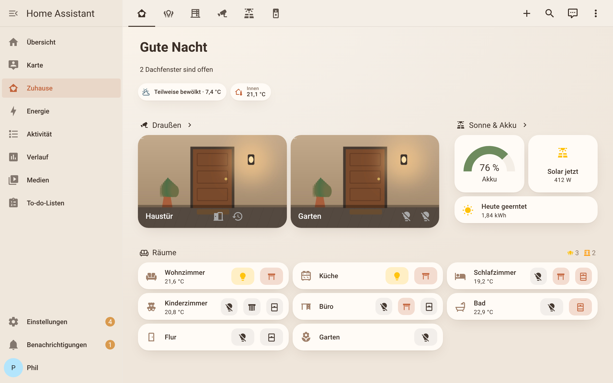
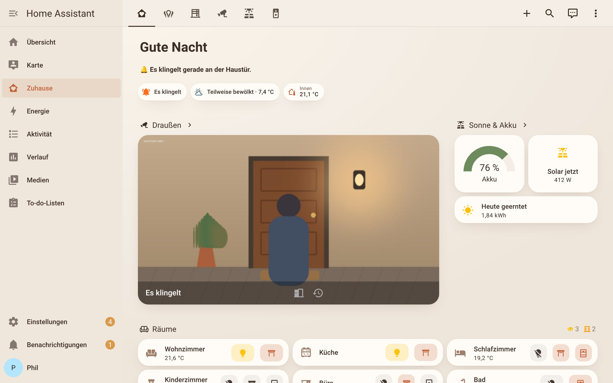
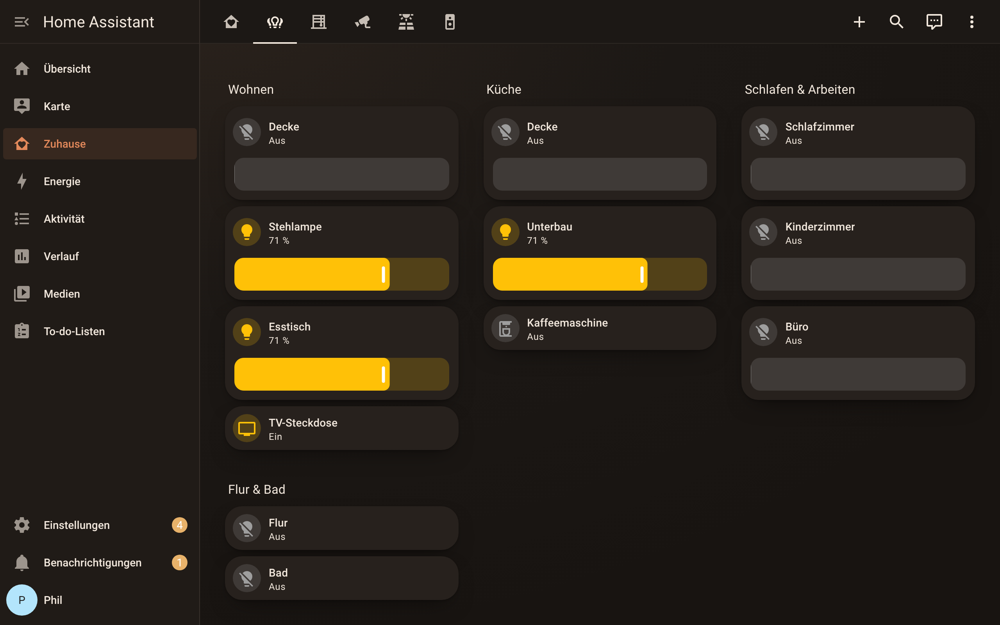
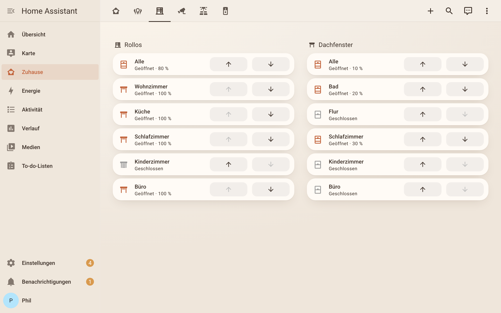
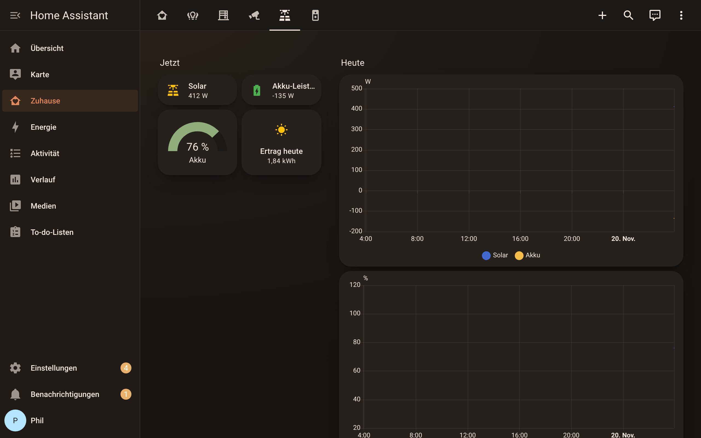

# Dashboard „Zuhause“

Eine Oberfläche für alles, im warmen „Cosy“-Look. Nur Bordmittel von Home Assistant: keine
Zusatzkarten, kein HACS, nichts, was bei einem Update kaputtgehen kann.

| Übersicht | Es klingelt |
| --- | --- |
|  |  |

| Licht (dunkel) | Rollos & Fenster | Energie (dunkel) |
| --- | --- | --- |
|  |  |  |

## Aufbau

**Übersicht**: kompakt, auf dem Tablet ohne Scrollen:

- Begrüßung und eine Zeile Status („Alles ruhig zu Hause“, „2 Dachfenster sind offen“, bei Regen
  „Es regnet und 2 Dachfenster sind offen!“)
- Plaketten: Wetter, Temperatur innen
- **Draußen**: beide Kamerabilder mit **Knöpfen im Bild** – Haustür: *Tür öffnen*, *Klingel-Verlauf*;
  Garten: Lichter. **Klingelt es**, wird die Haustür groß und **live**, 3 Minuten lang.
- **Sonne & Akku**: Akku als Anzeige, Solarleistung jetzt, Ertrag heute
- **Räume**: eine Karte pro Raum mit Temperatur und Knöpfen für Licht, Rollo und Dachfenster.
  Oben rechts „💡 3“ (Tipp: alle Lichter aus) und „Dachfenster 2“ (Tipp: alle schließen).

Ein Tipp auf eine Überschrift mit „›“ führt zur Detailseite:
**Licht** (alle 15 Aktoren nach Räumen, mit Helligkeit), **Rollos & Fenster** (alle 10 einzeln),
**Kameras** (beide live), **Energie** (Verlauf von heute), **Klingel** (letzter Besuch, Verlauf).

## Dateien

| Datei | Wohin | Inhalt |
| --- | --- | --- |
| `packages/klingel.yaml` | `/config/packages/` | Klingel: Timer, Tür-öffnen-Skript, Push, Telegram, Gong, Theme „Cosy“ |
| `packages/zuhause.yaml` | `/config/packages/` | Gruppen „Alle Lichter/Rollos/Dachfenster“, Zähler, Innentemperatur |
| `zuhause.yaml` | Raw-Editor des Dashboards | das Dashboard selbst |

## Einrichten

### 1. `configuration.yaml` (einmalig)

```yaml
homeassistant:
  packages: !include_dir_named packages
  allowlist_external_dirs:
    - /config/www/klingel
```

Falls `homeassistant:` schon existiert, nur die zwei Einträge ergänzen.

### 2. Platzhalter durch deine Geräte ersetzen

In allen drei Dateien mit Suchen & Ersetzen. Gibt es ein Gerät nicht, die Kachel bzw. Zeile löschen.

| Platzhalter | Was |
| --- | --- |
| `binary_sensor.klingel` | Klingeltaster |
| `camera.haustuer`, `camera.garten` | die zwei Kameras |
| `switch.tueroeffner` | Türöffner-Relais |
| `light.wohnzimmer_decke`, `light.wohnzimmer_stehlampe`, `light.esstisch`, `light.kueche`, `light.kueche_unterbau`, `light.flur`, `light.bad`, `light.schlafzimmer`, `light.kinderzimmer`, `light.buero`, `light.terrasse`, `light.garten` | 12 Lampen |
| `switch.steckdose_tv`, `switch.kaffeemaschine`, `switch.lichterkette` | 3 weitere Aktoren |
| `cover.rollo_wohnzimmer` … `cover.rollo_buero` | 5 Rollos |
| `cover.dachfenster_bad` … `cover.dachfenster_buero` | 5 Dachfenster |
| `sensor.balkonkraftwerk_leistung` | Solarleistung jetzt (W) |
| `sensor.balkonkraftwerk_ertrag_heute` | Ertrag heute (kWh) |
| `sensor.akku_ladestand` | Akku in % |
| `sensor.akku_leistung` | Akku lädt (+) / entlädt (−) in W |
| `sensor.temperatur_wohnzimmer`, `…_schlafzimmer`, `…_kinderzimmer`, `…_bad` | Raumtemperaturen |
| `weather.forecast_home` | Wetter (Standard-Name der Met-Integration) |
| `wohnzimmer`, `kuche`, `schlafzimmer`, `kinderzimmer`, `buro`, `bad`, `flur`, `garten` | Bereichs-IDs für die Raumkarten (stehen in der Adresszeile unter *Einstellungen → Bereiche*) |
| `notify.mobile_app_handy` | dein Android-Handy |
| `media_player.tablet_flur`, `media_player.handy_app` | browser_mod-Player für den Gong |
| `123456789` (2× in `klingel.yaml`) | Telegram-Chat- bzw. Benutzer-IDs |

Lampen, die zu einer Lampe gehören, die schon eine Gruppe ist, nicht doppelt eintragen.

### 3. Dateien ablegen und neu starten

- Beide Paketdateien nach `\\homeassistant.local\config\packages\`.
- Ordner `\\homeassistant.local\config\www\klingel\` anlegen, einen Gong als `gong.mp3` hineinlegen.
- **HA neu starten.**

### 4. Kamera „Letzter Besuch“ (für die Klingel-Seite)

*Einstellungen → Geräte & Dienste → Integration hinzufügen → Lokale Datei*,
Name `Klingel letzter Besuch`, Pfad `/config/www/klingel/letzter_besuch.jpg`.

### 5. Dashboard anlegen

*Einstellungen → Dashboards → Dashboard hinzufügen → Neues Dashboard von Grund auf*

- Titel `Zuhause`, URL **`dashboard-zuhause`** (darauf zeigen Push-Knöpfe und Links)
- Öffnen → Stift → ⋮ → **Raw-Konfigurationseditor** → Inhalt von `zuhause.yaml` einfügen → Speichern
- Zur Startseite machen: *Einstellungen → Dashboards → ⋮ bei „Zuhause“ → Als Standard festlegen*

### 6. Theme

*Profil → Design → Cosy*, damit auch Seitenleiste und Kopfzeile warm sind. Hell/Dunkel folgt dem
Gerät. Auf dem Tablet ebenso einstellen (bzw. in browser_mod).

### 7. Klingelton der Push (Android)

Nach der ersten Klingel-Push: *Android-Einstellungen → Apps → Home Assistant → Benachrichtigungen
→ Türklingel* → Ton wählen, „Nicht stören ignorieren“ einschalten.

## Was beim Klingeln passiert

1. Timer „Es klingelt“ läuft 3 Minuten: Livebild groß oben in der Übersicht, Status oben,
   Push- und Telegram-Knöpfe gültig. Danach öffnen alte Nachrichten nichts mehr.
2. Schnappschuss für „Letzter Besuch“.
3. Gong über browser_mod (Tablet, offene HA-App), Push aufs Handy, Telegram mit Foto.
4. 10 Sekunden Entprellung.

„Tür öffnen“ fragt kurz nach und gibt einen 2-Sekunden-Impuls. Startet HA mitten im Impuls neu,
wird das Relais beim Start abgeschaltet.

## Raumkarten

Die Raumkarten holen sich Licht, Rollos, Dachfenster und Temperatur **selbst** aus den Bereichen von
Home Assistant. Dafür müssen die Geräte nur dem richtigen Bereich zugeordnet sein
(*Einstellungen → Bereiche*). Neue Lampen erscheinen dann automatisch, ohne das Dashboard anzufassen.

## Getestet

In einem Test-HA (2026.2) mit nachgebauten Geräten: alle Seiten, Hell/Dunkel, Tablet und Handy,
Klingeln → Livebild oben, Öffnen per Dashboard und per Push (nur während der 3 Minuten).
Push, Telegram und browser_mod selbst gab es dort nicht. Fehlt einer dieser Dienste bei dir,
die betreffende Zeile in `klingel.yaml` löschen.
