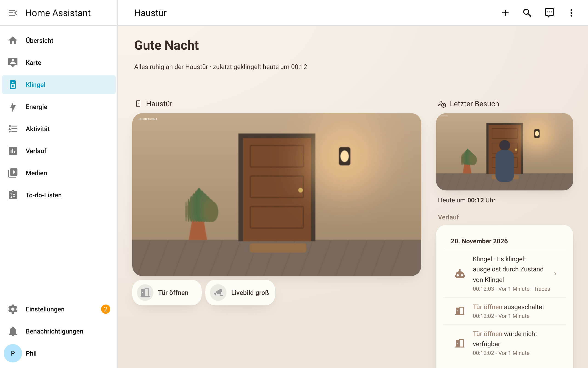
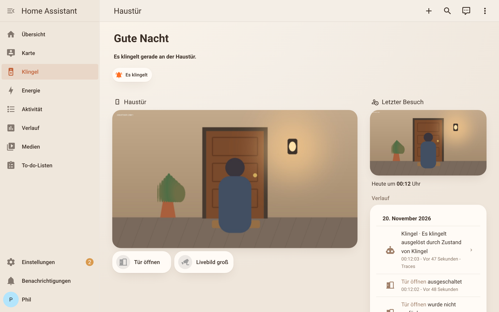
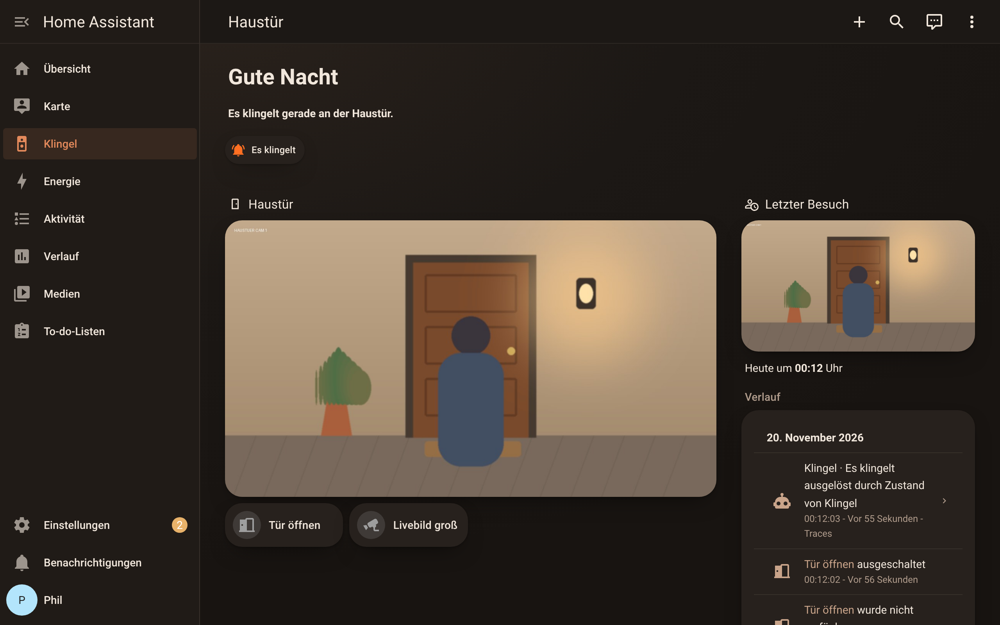

# Klingel-Dashboard – die schlanke Variante

Türklingel nur mit Bordmitteln von Home Assistant: keine eigene Integration, kein Lader, nichts,
was bei einem HA-Update kaputtgehen kann. Ein Dashboard im warmen „Cosy“-Look, eine Paketdatei
mit Helfern, Skript und Automationen.

| Ruhig | Es klingelt | Abends (dunkel) |
| --- | --- | --- |
|  |  |  |

## Was passiert beim Klingeln

1. Der Timer **„Es klingelt“** läuft 3 Minuten. Solange er läuft:
   - zeigt das Dashboard das **Livebild** (sonst ein ruhiges Standbild),
   - steht oben „Es klingelt gerade an der Haustür“ mit Glocke,
   - gelten die „Tür öffnen“-Knöpfe in Push und Telegram. Danach öffnen alte Nachrichten nichts mehr.
2. Ein **Schnappschuss** wird gespeichert und unter „Letzter Besuch“ gezeigt.
3. **Gong** auf allen gewählten browser_mod-Geräten (Tablet, HA-App am Handy).
4. **Push** aufs Android-Handy mit Bild und den Knöpfen „Tür öffnen“ und „Livebild“.
5. **Telegram** mit Foto und Knopf „🚪 Tür öffnen“. Öffnen dürfen nur eingetragene Benutzer.
6. 10 Sekunden lang wird erneutes Drücken ignoriert (Entprellung).

„Tür öffnen“ auf dem Dashboard fragt kurz nach und gibt dann einen 2-Sekunden-Impuls. Startet HA
mitten im Impuls neu, schaltet eine Automation das Relais beim Start sicher ab.

## Einrichten

### 1. `configuration.yaml` (einmalig)

```yaml
homeassistant:
  packages: !include_dir_named packages
  allowlist_external_dirs:
    - /config/www/klingel
```

Falls `homeassistant:` schon existiert, nur die zwei Einträge ergänzen.

### 2. Dateien ablegen (über Samba)

- `packages/klingel.yaml` → `\\homeassistant.local\config\packages\klingel.yaml`
- Ordner `\\homeassistant.local\config\www\klingel\` anlegen und einen Gong als `gong.mp3` hineinlegen.

In `klingel.yaml` oben die Platzhalter ersetzen:

| Platzhalter | durch |
| --- | --- |
| `binary_sensor.klingel` | deinen Klingeltaster |
| `camera.haustuer` | deine Kamera |
| `switch.tueroeffner` | dein Türöffner-Relais |
| `notify.mobile_app_handy` | dein Handy |
| `media_player.tablet_flur`, `media_player.handy_app` | die browser_mod-Player, die klingeln sollen |
| `123456789` (2×) | Telegram-Chat-ID bzw. erlaubte Benutzer-IDs |

Danach **HA neu starten** (Pakete werden nur beim Start gelesen).

### 3. Kamera „Letzter Besuch“

*Einstellungen → Geräte & Dienste → Integration hinzufügen → Lokale Datei*

- Name: `Klingel letzter Besuch`
- Pfad: `/config/www/klingel/letzter_besuch.jpg`

Das ergibt `camera.klingel_letzter_besuch`. Falls noch kein Bild existiert, einmal klingeln.

### 4. Dashboard anlegen

*Einstellungen → Dashboards → Dashboard hinzufügen → Neues Dashboard von Grund auf*

- Titel: `Klingel`, URL: `dashboard-klingel` (darauf zeigen die Push-Knöpfe)
- Dashboard öffnen → Stift → ⋮ → **Raw-Konfigurationseditor** → Inhalt von
  `dashboard/klingel.yaml` einfügen, Entitäten ersetzen, speichern.

### 5. Theme für alles (optional)

Das Dashboard nutzt „Cosy“ automatisch. Damit auch Seitenleiste und Kopfzeile warm werden:
*Profil → Design → Cosy*. Hell/Dunkel folgt dem Gerät.

### 6. Klingelton für die Push-Nachricht (Android)

Nach der ersten Klingel-Push: *Android-Einstellungen → Apps → Home Assistant → Benachrichtigungen
→ Türklingel* → Ton wählen, „Wichtig“/„Nicht stören ignorieren“ einschalten.

## Auf dem Hauptscreen

Wer das Bild lieber im bestehenden Dashboard hat: die erste Sektion („Haustür“) im Raw-Editor in
das eigene Dashboard kopieren. Sie funktioniert dort genauso.

## Hinweise

- Getestet mit Home Assistant 2026.2 in einem Test-HA: Klingeln → Livebild und Schnappschuss,
  Öffnen per Dashboard und per Push (nur während der 3 Minuten). Push, Telegram und browser_mod
  selbst konnten dort nicht getestet werden.
- Fehlt ein Dienst ganz (z. B. Telegram nicht eingerichtet), Zeile im Paket einfach löschen.
